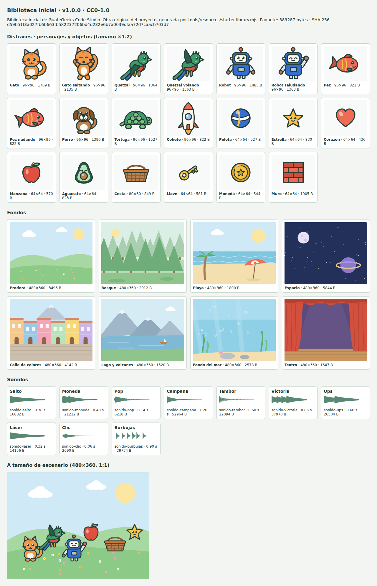
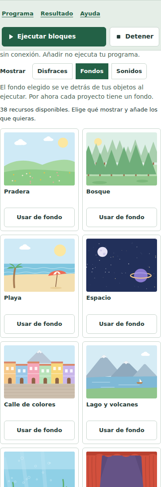

# Resultados: biblioteca inicial de recursos (E4)

29 de octubre de 2026, Guatemala. Cambio OpenSpec `resources-starter-library`, etapa **E4** del [plan de estabilización 2D](../product/STABILIZATION-PLAN-2D.md) (pista B, en paralelo con E1). Rama `stab/e4-resources` desde `356c08b`. La puerta full conjunta la ejecuta la coordinación; este acta registra solo verificaciones parciales.

## Qué se entrega

| Pieza | Archivo |
|---|---|
| Generador reproducible (dibujo SVG por código y síntesis WAV) | `tools/resources/starter-library.mjs` |
| Bloqueo versionado con SHA-256 por entrada | `tools/resources/starter-library.lock.json` |
| Captura de la hoja de contacto | `tools/resources/capture-contact-sheet.mjs` |
| Contrato inerte: validación del índice y aplicación a recursos v1 | `src/contracts/starter-library.mjs` |
| Presentación de la sección Biblioteca | `src/studio/starter-library-ui.mjs` |
| Transacción (mismo worker, contratos y `replaceAuthoring`) | `src/studio/resources-ui.mjs` |
| Marcado y estilos mínimos | `src/studio/index.html`, `src/studio/style.css` |
| Etapa de build `starter-library` → `shell/starter-library.json` | `tools/f0/build-browser.mjs` |
| SBOM `ownedContent` y avisos | `tools/release/materials.mjs`, `THIRD_PARTY_NOTICES` |

### Contenido (38 entradas, nombres visibles en español)

- **20 disfraces** (`costume`). Personajes 96×96: Gato y Gato saltando, Quetzal y Quetzal volando, Robot y Robot saludando, Pez y Pez nadando (cuatro pares para animar con «siguiente disfraz» de E1), Perro, Tortuga y Cohete. Objetos 64×64 (Cesta 80×60): Pelota, Estrella, Corazón, Manzana, Aguacate, Cesta, Llave, Moneda y Muro. Cubren «Atrapa la fruta» (cesta, manzana, aguacate) y «Laberinto» (muro, llave, moneda, estrella).
- **8 fondos** 480×360 en tonos suaves para que los objetos destaquen: Pradera, Bosque, Playa, Espacio, Calle de colores, Lago y volcanes, Fondo del mar y Teatro.
- **10 sonidos** PCM16 mono a 22 050 Hz, de 0,06 a 1,2 s: Salto, Moneda, Pop, Campana, Tambor, Victoria, Ups, Láser, Clic y Burbujas.

Estilo: paleta derivada de `DESIGN.md` y del `hero` de demostración (coral, azul, verdes, crema, tinta), contorno de tinta de 3 px redondeado, ojos con brillo y mejillas; motivos locales (quetzal, aguacate, calle de colores, lago y volcanes). Es una dirección propia de la biblioteca, no una marca aprobada.

La hoja (HTML → Chromium de Playwright) incluye los disfraces a ×1,2, los fondos, la envolvente de cada sonido y una composición a tamaño de escenario 1:1. Iteraciones en `artifacts/stabilization-2d/e4-resources/contact-sheet/` (v1 → v2: colas y patas recortadas por el lienzo, triángulo sin sentido en Playa sustituido por una sombrilla, mancha del Teatro sustituida por un haz de luz; v3: formas de onda; `final`: la del bloqueo).

## Decisiones

1. **Obra original generada por código.** Ningún medio procede de Scratch, MakeCode ni Code.org. Los SVG usan solo el subconjunto pasivo admitido (`rect`, `circle`, `ellipse`, `path`, `polygon`, `line`, `g`) y se publican ya normalizados por `sanitizeSvg`; los WAV se escriben con la misma cabecera canónica que `editWavPcm16`. Así el ID del recurso en el proyecto **es** el SHA-256 declarado y el worker lo comprueba al añadir.
2. **Licencia CC0-1.0**, igual que el corpus SB3 propio. Los medios acaban dentro de proyectos y SB3 exportados por estudiantes; CC0 no les impone condiciones (AGPL-3.0-only sigue cubriendo el código, incluido el generador). Declarada en el índice, el bloqueo, `THIRD_PARTY_NOTICES` y `SBOM.json → ownedContent`. **Pendiente de confirmación del usuario.**
3. **Un paquete en el origen del estudio.** `starter-library.json` vive solo en el rol shell (no se replica en los seis roles como `app/`) y entra en el paquete offline `studio-core`. Se resuelve con `new URL('../../starter-library.json', import.meta.url)`, válido en desarrollo y bajo `/releases/<cohorte>/` sin reescritura.
4. **Carga bajo demanda.** Nada se descarga al arrancar el estudio: el paquete se pide al abrir «Biblioteca» (no toca el arranque que investiga la otra pista). Se verifica el SHA-256 de las 38 entradas antes de mostrarlas.
5. **IDs legibles.** El descriptor usa el ID de la entrada (`gato`, `sonido-salto`) porque aparece en las vistas JavaScript/Python (`hero.setCostume("gato")`); si choca se añade `-2…`. Añadir dos veces no duplica.
6. **Volver al fondo inicial** toma el fondo del catálogo del proyecto, no de la biblioteca: la cuadrícula conserva su procedencia. El botón solo aparece si el fondo actual no es el inicial (se reconocen el ID SHA-256 promovido y el MD5 del catálogo legado).
7. **UI sin contextual-workspace.** Todo vive dentro del panel Recursos existente; no se tocó `contextual-workspace.mjs`.

## Límite honesto: qué funciona hoy y qué habilita E2

| Hoy (verificado) | Requiere E2 `scene2d-multi-sprite` |
|---|---|
| Añadir disfraces al único objeto `hero`; aparecen en el menú «disfraz» de Recursos locales | Disfraces para otros objetos y añadir un objeto nuevo desde la biblioteca |
| Añadir sonidos a `hero`; aparecen en «iniciar sonido» y «sonido … y esperar» | Sonidos por objeto |
| Usar un fondo como **fondo inicial** del escenario (sustituye el medio del disfraz del escenario, como ya hacía «Reemplazar») y volver al inicial | Varios fondos por escenario y bloque «cambiar fondo» (proyecto «Diálogo») |

Los fondos y personajes ya son datos de biblioteca validados; E2 solo necesita destinos nuevos para `applyStarterLibraryEntry` (propietario y rol), no medios nuevos. No se amplió IR, bloques ni packs.

## Bytes añadidos

| Medida | Bytes |
|---|---|
| Medios en bruto: 20 disfraces / 8 fondos / 10 sonidos | 21 026 / 23 939 / 240 344 (total 285 309) |
| `starter-library.json` sin comprimir (base64 + índice) | **389 287** |
| gzip -9 / gzip -6 / brotli | 231 149 / 231 322 / 222 125 |
| Cohorte offline | +389 287 B en el rol shell, paquete `studio-core`; 0 B en los otros cinco roles |
| SHA-256 del paquete | `d59b51f3a027fb6b663fb582237206bd4d232e6b7a0039dfaa72d7caacb703d7` |

Un proyecto solo crece con lo que añade (p. ej. Gato 1 769 B, Teatro 1 647 B, Salto 16 802 B, más base64 en el GGPROJ). Cuotas existentes: 16 sonidos, 32 disfraces, 32 medios y 2 MiB; al alcanzarlas el mensaje propone reemplazar un recurso, porque hoy no existe eliminar.

## Verificación

Entorno: WSL, Node v22.23.4, puertos propios 5500–5503/5508/5509, `GG_RELEASE_ROOT=artifacts/stabilization-2d/e4-resources/releases`. Máquina compartida con otras dos pistas (carga entre 1 y 10 durante las corridas). El reporte JSON del lote A no se generó porque `--reporter=line` sustituye los reporteros de la configuración; su evidencia es `focal-a.log` y las trazas.

| Comando | Resultado |
|---|---|
| `npm test` | 479/479 (incluye 5 nuevas de `tests/integration/starter-library.test.mjs`) |
| `npm run test:tools` | 82/82 (incluye 3 nuevas de `tests/tools/starter-library.test.mjs` y la aserción nueva de SBOM/avisos en `release-materials`) |
| `npm run spec:validate` | 38/38 |
| `node tools/resources/starter-library.mjs --check` | Reproduce el bloqueo |
| `npm run browser:build` | Etapa `starter-library` construida y verificada contra el bloqueo |
| `npx playwright test tests/browser/starter-library.spec.mjs` | 3/3 (intento 5; intentos 1–4 conservados, ver abajo) |
| Suites focales lote A (11 specs: `starter-library`, `sb3-resources`, `resource-safety`, `integrated-scratch-workspace`, `integrated-2d-workspace`, `workspace-presentation`, `accessibility-shell`, `accessibility-runner`, `studio-contextual-workspace`, `studio-entry-journey`, `educational-activities`) | 88/89 en 23,2 min; el fallo es el arranque bloqueado conocido (ver abajo). `accessibility-runner` aislado: 7/7 |
| Suites focales lote B (7 specs: `bindings-editor`, `device-transfer`, `integrated-3d-workspace`, `integrated-microbit-workspace`, `integrated-web-workspace`, `packs-lessons`, `textual-equivalence`) | 32/34 en 11,4 min. `packs-lessons` (móvil): arranque bloqueado; aislada 9/9. `device-transfer`: pide `http://127.0.0.1:4173…4176` fijos y no puede correr en puertos alternativos (ver abajo) |

### E2E nuevo (`tests/browser/starter-library.spec.mjs`)

1. **GG-LIB-004/005/006/007.** El arranque no pide la biblioteca; abrirla hace una petición. La docente prepara el uso sin red (`#prepare-offline`, cohorte confirmada); **otra visita con `context.setOffline(true)`** abre el estudio desde la cohorte, la biblioteca llega del service worker (`fromServiceWorker`), se añaden Gato, Salto y Teatro sin ninguna petición fallida, «Gato» repetido no duplica, nada se ejecuta (mismo estado y 0 hilos). Los menús reales de Blockly ofrecen `hero, hero-alt, Gato` y `tone, Salto`. Ejecutar muestra el disfraz `gato` y el telón rojo (> 10 000 píxeles rojos). El GGPROJ descargado sin red se abre en un perfil nuevo con recursos y bloques idénticos, sin pedir la biblioteca, y produce el mismo resultado. «Volver al fondo inicial» deja < 2 000 píxeles rojos.
2. **GG-LIB-008.** A 390 px, solo teclado: Enter abre la sección, flechas eligen Sonidos, Enter añade Pop con el foco visible en el mismo botón; Escuchar/Detener Campana con el mismo control y sin hilos; botones ≥ 44 px; sin desbordamiento horizontal; un proyecto nuevo no muestra «Volver al fondo inicial».
3. **GG-LIB-003/008.** Biblioteca no disponible (503) y manipulada (un byte cambiado → «no coincide con su SHA-256»): mensaje en español, Reintentar, filtro desactivado, proyecto intacto; tercer intento carga.

### Interfaz (gg-ui-verification)

Capturas en `artifacts/stabilization-2d/e4-resources/ui-v2/` con métricas (`metrics.json`): 1280×720, 1440×900, 390×844, 640×360 (≈ 1280×720 al 200 %) y 320×180 (≈ 400 %). Sin desbordamiento horizontal en ninguna; 2–4 columnas; botones de 44 px. Son viewports emulados, no zoom real del navegador (`accessibility-zoom` es de partición 0). Corrección tras la primera ronda (`ui-v1`): el estado se movió encima de la lista (en estrecho quedaba lejos de la acción), las tarjetas de sonido muestran la forma de onda en vez de un icono genérico, y «Volver al fondo inicial» aparecía en proyectos nuevos por la diferencia de IDs MD5/SHA-256 del catálogo legado.

Detector Impeccable (`impeccable detect`, `artifacts/stabilization-2d/e4-resources/impeccable-detect.json`): mismos seis avisos que `index.html`/`style.css` de la base; el único aviso nuevo (radio de 4 px fuera de escala) se corrigió con `--gg-radius`. Impeccable se ejecutó sin la entrevista interactiva: como subagente sin herramienta de preguntas, la dirección se tomó del brief, `DESIGN.md` y el sidecar.

**Limitación observada:** a 1280×720 la consulta deja ~95–140 px visibles bajo el resultado (diseño vigente), así que la biblioteca se recorre con el desplazamiento del panel. Mejorarlo (por ejemplo, abrir la biblioteca en la vista ampliada) requiere tocar la distribución y queda para la coordinación.

### Intentos fallidos conservados

En `artifacts/stabilization-2d/e4-resources/starter-library-attempt{1..4}*`:

1. Sin red y sin service worker, añadir falló («No se pudo preparar el procesador local»): el worker de recursos se descarga en cada operación y el servidor de desarrollo usa `no-store`. Conclusión: «sin red» solo es cierto con la cohorte preparada; la prueba pasó a usar la preparación real. Además, `page.route` no interceptaba la petición (la cubre el service worker): se usa `context.route`. Y `.library-state` estaba duplicado en sonidos (renombrado a `.library-meta`).
2. JSON de Blockly mal formado en la prueba (cuerpo del sombrero en `next` en lugar de la entrada `DO`).
3. Selector del desplegable demasiado amplio (abría el menú de sonido); `toBeDisabled` no aplica a `fieldset`.
4. Aprobado; el 5 añade escucha previa y fondo inicial en proyecto nuevo.

### Arranque bloqueado (defecto abierto, registrado en TESTING)

En el lote A, `GG-F7-RUNNER: semantic target … independent javascript document` (`accessibility-runner`, caso 3 de 89) falló en `open()`: la espera de 15 s de `expect('#run-editor').toBeEnabled()` tardó **120,2 s** (123,2 s el paso de la prueba) y la consola registró varias veces `The AudioContext encountered an error from the audio device or the WebAudio renderer.` Es la misma firma de las ocurrencias del 25/10 y el 29/10. Ocurrió al cargar la página, antes de abrir la biblioteca (que no se descarga ni ejecuta nada en el arranque). Carga de la máquina en ese tramo: 7–10. La spec aislada aprobó 7/7. En el lote B se repitió en `GG-LESSON: independent text transition … (mobile)` (`packs-lessons`): `waitForFunction(studioProbe.project)` agotó 120 s (129,6 s), con cinco errores de `AudioContext`; aislada 9/9 (traza en `focal-b-output/packs-lessons-GG-LESSON-in-ac3c8-and-original-blocks-mobile-/`). Son la tercera y cuarta ocurrencias registradas, ambas antes de cualquier código de la biblioteca. Traza: `artifacts/stabilization-2d/e4-resources/focal-a-output/accessibility-runner-GG-F7-e59f7-pendent-javascript-document/` (tercera ocurrencia; no se tocaron pruebas ni tiempos). La coordinación puede añadirla a la tabla de [TESTING](TESTING.md#fallos-intermitentes-conocidos); esta pista no edita ese archivo para no chocar con la investigación de arranque.

## Suites para la puerta conjunta

- Partición 0 que este cambio afecta y no se ejecutó aquí: **`offline-recovery`** (cohorte con el paquete nuevo), `accessibility-zoom`, `project-persistence`, `audio-variables`, `code-console`, `device-integration`, `language-runtime`, `scene-inspector`, `textual-corpus` (selección por HTML/CSS).
- **`device-transfer` no está en `defaultPortSuites` pero comprueba `http://127.0.0.1:4173…4176` literalmente** (la expresión de `tests/tools/test-partitions.test.mjs` no lo detecta porque construye la URL con `+ origin`). En una partición ≥ 1 fallará o consultará otro servidor. No se corrigió aquí (herramienta compartida); se propone añadirla a la partición 0 o leer los puertos del entorno.
- `starter-library.spec.mjs` está en `normalBrowserFiles` y en el grupo `scratch-import`; no fija orígenes por defecto.
- `tools/resources/*` y `tools/f0/build-browser.mjs` clasifican como full (regla conservadora vigente).

## Pendientes

- Confirmar la licencia CC0-1.0 de la biblioteca.
- Revisión humana de los dibujos y sonidos con docentes/estudiantes (la hoja no mide comprensión ni agrado).
- E2: destinos por objeto y varios fondos; E1: «siguiente disfraz» aprovechará los pares.
- Eliminar recursos de un proyecto (hoy solo reemplazar).
