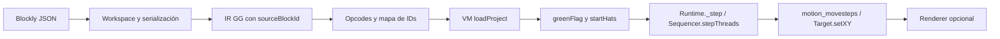
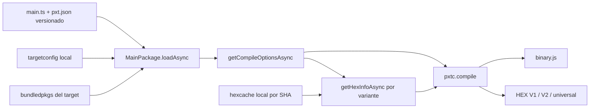

# Mapa de integración — fase 0

**21 de octubre de 2026.** Construido mediante consultas CodeGraph y lectura/ejecución del código correspondiente. Las revisiones exactas están en [provenance.json](provenance.json). Los resultados completos de consultas se guardan en `artifacts/codegraph/queries/`; regenerar con `npm run analyze`.

## 1. Inventario de índices

| Índice | Archivos | Nodos | Aristas |
|---|---:|---:|---:|
| Blockly | 958 | 15 392 | 51 824 |
| Xcratch | 757 | 9 441 | 23 681 |
| Target micro:bit | 147 | 4 947 | 7 640 |
| PXT Core 13.0.1, source exacto | 1 496 | 48 570 | 105 692 |

Studio tiene un quinto índice que cambia al añadir pruebas/herramientas. Los cuatro índices upstream cubren 3 358 archivos. Nodos incluye archivos, imports, propiedades y otros símbolos; las aristas no equivalen todas a llamadas ejecutables.

Los presets excluyen bibliotecas instaladas, builds, traducciones y documentos voluminosos. Algunos fixtures deliberadamente inválidos de PXT no producen símbolos; CodeGraph los advierte. El análisis de carga dinámica se contrastó con el código y los spikes: un grafo estático no garantiza cobertura completa.

## 2. Blockly a VM 2D

Puntos de entrada verificados:

- Blockly: `packages/blockly/core/serialization/workspaces.ts`; renderer `core/renderers/zelos/renderer.ts`. La generación de código sigue separada de la ejecución; el spike utiliza serialización pública y bloques propios.
- Xcratch: `packages/scratch-vm/src/virtual-machine.js`, `loadProject` en línea 312; `greenFlag` en 193; `stopAll` en 223.
- Scheduler: `src/engine/sequencer.js`, `stepThreads` en línea 70; `src/engine/runtime.js`, `_step` en 2143. Es necesario iniciar el runtime: `start()` establece el presupuesto temporal; llamar `_step()` con `currentStepTime` sin inicializar no ejecutaba los scripts.
- Estado: `src/sprites/rendered-target.js`, `setXY` en 266. La posición se actualiza también sin renderer, lo que habilita caracterización headless; eso no demuestra renderizado.
- Renderer: `packages/scratch-render/src/RenderWebGL.js`, `createSVGSkin` en 360, `createDrawable` en 479 y `draw` en 651.

El fixture preserva `start`, `repeat` y `move` como IDs. El motor llega a `x=15`, conserva la autoría inicial y permite serializar/reabrir una captura de ejecución. El camino se implementa en `spikes/block-program.mjs` y `spikes/scratch-adapter.mjs`.

## 3. Compilación PXT

Fuente PXT analizada: commit `af4bcc89fd2114b6ec232860ce0458cb9aa0dd28`, extraído en `.tools/pxt-core-source/`.

- `pxtcompiler/simpledriver.ts:191`: `simpleCompileAsync` llama `simpleGetCompileOptionsAsync` y después `pxtc.compile`.
- `pxtcompiler/simpledriver.ts:99`: `SimpleHost.getHexInfoAsync` devuelve un marcador SKIP. El spike lo reemplaza mediante un Host derivado que lee cachés nativos locales.
- `pxtlib/main.ts:509`: `targetConfigAsync` solicita configuración del target. La primera ejecución intentó `https://www.makecode.com/api/config/microbit/targetconfig/v9.1.1`; se resolvió mediante el flujo estático y un handler local de `targetconfig.json`.
- `pxtlib/package.ts`: `getCompileOptionsAsync` calcula dependencias, declaraciones y variantes; consulta el Host para cada runtime nativo. No equivale a compilar una cadena TS sin proyecto.
- `cli/cli.ts:3363`: el Host CLI comprueba `built/hexcache/<sha>.hex` antes de recurrir a compilación remota/local. El adaptador reproduce solamente la lectura local necesaria y falla si falta el runtime.

**Hallazgo sobre los paquetes:** una configuración inicial con solo core y sin `targetVersions` activó parches de migración, añadió microphone y produjo hashes nativos ausentes. Declarar las versiones actuales y los paquetes estándar `core`, `radio`, `microphone` reprodujo la combinación cubierta por los cachés existentes:

| Variante | Hash de configuración requerido |
|---|---|
| `mbdal` | `949fbd03bf2de1d4bf409bb1e68613a9d8745ca0bbafef44aa472a60ef9c0f73` |
| `mbcodal` | `354b97da4696027afdaa3977420ec181bfc88a2faa2d2c0174842767718551e7` |

Los hashes de configuración identifican combinaciones de runtime; no son los SHA-256 del contenido de los HEX. Los hashes de archivos están registrados por separado en provenance.json. Una extensión adicional puede requerir otra combinación y otro artefacto.

## 4. Importación y extensiones

Ruta: `VirtualMachine.loadProject → deserializeProject → extensionManager.loadExtensionURL`. Los metadatos del archivo pueden determinar extensiones a cargar.

`packages/scratch-vm/src/extension-support/extension-manager.js:384` resuelve extensiones incorporadas, importa formatos Xcratch externos y ofrece una ruta TurboWarp con acceso no aislado al runtime. El spike rechaza URLs y catálogos externos antes de llamar a la VM. No es un saneador general de SB3: faltan límites ZIP, validación de SVG y análisis completo de permisos para admitir proyectos arbitrarios.

## 5. Componentes de interfaz y propiedad del estado

`PaintEditorWrapper` importa React, `react-redux`, VM, `scratch-paint` y utilidades SVG. Su consumidor directo identificado por CodeGraph es `costume-tab.jsx`. Sus handlers llaman a `vm.renameCostume` y `vm.updateSvg`; no es un widget independiente del estado de Scratch.

`SoundEditor` añade utilidades y efectos de audio, `AudioBufferPlayer`, encoder WAV, componentes de UI y conexión a Redux/VM. La extracción requiere decidir qué estado expone el adaptador. La instalación resolvió `@xcratch/scratch-storage@5.0.3`, fijado por el lockfile upstream.

`packages/scratch-vm/src/dispatch/central-dispatch.js:143` exporta una **instancia única**. Crear varias VM en el mismo contexto reemplaza sus servicios runtime/extensions y emite avisos. Para el producto, mantener una VM por contexto de runner y destruir/recrear el frame al forzar reinicio; no construir concurrencia de proyectos sobre varias VM dentro del mismo módulo compartido.

## 6. Decisiones que habilita el análisis

1. Continuar la prueba de Scratch VM/render como backend 2D: el desacoplamiento headless es viable.
2. Mantener PXT como adaptador: la generación de simulación y HEX funciona fuera de la GUI en Node con un Host local.
3. Mantener versiones, perfil de placa y combinación de paquetes como entradas del compilador y del cacheado.
4. Tratar importación, red y sesión como fronteras explícitas, sin delegar confianza al cargador original.
5. El escenario renderizado en un frame de otro origen ya pasa; ampliar el corpus antes de cerrar G1.

## 7. Rutas de navegador verificadas

El [informe de navegador](BROWSER-RESULTS.md) registra seis E2E aprobados. La ruta 2D conserva Blockly→IR→VM, añade assets SVG propios por un Helper de Scratch Storage y une VM/renderer dentro del runner `127.0.0.1:4174`. El anfitrión en `127.0.0.1:4173` transfiere un MessagePort tras validar origin/source/sesión. El fixture fijo se valida con scratch-parser durante el build y se carga con deserializeProject para evitar la generación dinámica de funciones de AJV bajo CSP.

PXT usa importScripts de TypeScript/pxtworker en un worker subordinado al runner. Un pack estático contiene bundledpkgs, targetconfig y hexcache; el Host resuelve los dos runtimes anteriores sin servidor de compilación. El hook micro:bit se importa desde built/compiler.js, contrastado con compilerExtension del target; LZMA browser mantiene la fuente embebida sin activar la detección Node legacy. Se genera JS, HEX por variante y universal con el contexto desconectado después de la precarga.

Estas rutas están en `spikes/browser/`; el build y los servidores están en `tools/f0/build-browser.mjs` y `serve-browser.mjs`. No sustituyen un importador de proyectos general, una PWA ni la validación del firmware físico.

## 8. Corpus y ejecución micro:bit

El [corpus ampliado](CORPUS-SIMULATOR-RESULTS.md) conserva la cadena Blockly→IR→VM e incorpora hats de tecla/clic/broadcast/clon, control_wait, event_broadcastandwait, control_create_clone_of y control_delete_this_clone. Mouse.postData entrega sus coordenadas directamente a Renderer.pick, que espera unidades CSS; la conversión a coordenadas Scratch se hace dentro del dispositivo de entrada. El E2E escala el canvas y usa entrada DOM real para cubrir esa frontera. La VM y el renderer se reutilizan al cambiar de fixture, con clear para liberar targets anteriores.

La fuente PXT `pxtsim/runtime.ts:1635` evalúa el código generado y `pxtsim/embed.ts:422` muestra la secuencia Runtime→board.initAsync→run. `sim/dalboard.ts` instala initCurrentRuntime, construye DalBoard con LedMatrixState y crea el SVG de la placa. El adaptador reproduce esa secuencia en un tercer origen, sin iniciar el receptor global de Embed: un script previo a load neutraliza Embed.start, cuyo arranque está registrado por el bundle oficial.

Runtime y placa se leen de los bundles locales exactos; la matriz de LEDs se contrasta con el SVG y el hash del binary.js recibido con el producido por el worker. Los índices y consultas adicionales se guardan en `artifacts/codegraph/queries/browser-*`. Los E2E cubren corazón, evento de botón A, rechazo de run global y destrucción del contexto al detener.

## 9. Estado numérico y audio

Los bloques de variables y condicionales se traducen a data_setvariableto, data_changevariableby, data_variable, operator_equals/lt/gt y control_if/if_else. El ID de declaración se conserva en los campos VARIABLE de la VM; los IDs de expresiones y de ambas ramas forman parte del mapa de origen. La VM recibe una copia de la autoría, manteniendo separados estado inicial y ejecutado. Los movimientos notifican la posición al anfitrión por el mismo puerto de sesión para actualizar la vista previa.

`VirtualMachine.attachAudioEngine` conecta el motor antes de cargar sonidos; `src/import/load-sound.js` usa decodeSoundPlayer y añade el resultado al SoundBank del sprite. `scratch3_sound.js` devuelve la promesa de SoundBank.playSound para sound_playuntildone y detiene bancos al recibir PROJECT_STOP_ALL. La dependencia local scratch-audio 2.0.268 usa AudioBufferSourceNode y finalización real de Web Audio, con un breve fade al detener.

El Helper de assets entrega el WAV generado por `tools/f0/tone.mjs`. Un AnalyserNode después del nodo maestro mide salida y silencio. Se verifica el gesto en un botón del runner, sin flags de autoplay. Shutdown detiene los motores y cierra AudioContext; el anfitrión limita la espera a 150 ms antes de retirar el frame. La prueba usa CDP del contexto de audio para observar closed. Ver [resultados y límites](AUDIO-STATE-RESULTS.md); las consultas CodeGraph están en `artifacts/codegraph/queries/audio-*` y se contrastaron con el código de la dependencia instalada, excluida de los índices upstream.

## 10. Bindings GG y workspace editable

Blockly visible usa `spikes/browser/shell/editor-entry.mjs` y el mismo adaptador workspaceToIR. La traducción se movió a `spikes/scratch-project.mjs`, reexportada para conservar consumidores existentes; `program-contract.mjs` valida la frontera sin dependencia de editor ni VM. El runner carga esos módulos ESM locales y construye proyectos con recursos propios, después de rechazar IR inválida. Añade projectVersion=3, que la ruta anterior recibía de scratch-parser, antes de llamar deserializeProject.

`spikes/gg-client.mjs` define el vocabulario público asíncrono. `gg-bindings.mjs` es el adaptador al único estado VM: movimiento usa motion_movesteps; posición usa setXY; variables usan el modelo local del target; mensajes declarados pasan por lookupBroadcastMsg→startHats. Los DTOs solo contienen datos propios. El cliente captura sesión/revisión y el runner valida de nuevo la revisión, incluyendo las cargas de corpus.

Las consultas `artifacts/codegraph/queries/gg-*` y la lectura del código identificaron las fronteras de movimiento, mensajes y CSS. El editor Blockly necesita hojas y posiciones dinámicas, por lo que se amplía style-src solo en el anfitrión. Scripts del shell, runner y compilador permanecen self, con la excepción previa del simulador en su origen separado. Ver [evidencia y alcance](BINDINGS-EDITOR-RESULTS.md).

## 11. Corpus mínimo y medición de cierre

La consulta `scratch-variable-scope.json` y el código de `lookupVariableById` confirman la búsqueda local y después en Stage. La IR añade `scope: global` solo cuando el bloque `gg_set_global` declara ese ID; sin scope conserva local. El traductor reparte las declaraciones entre Stage y hero. `makeClone` conserva la referencia global y copia las variables locales: el fixture deja globalScore=17, local original=3 y local clon=5; recargar restaura ambos ceros.

`scratch-costume-switch.json` identifica la ruta nativa de `looks_switchcostumeto`. El bloque `gg_set_costume` solo acepta hero/hero-alt, empaquetados desde dos SVG propios. El test observa píxeles rojos→azules→rojos y el nombre del disfraz nativo. El fixture concurrent inicia dos hats, observa ambas esperas activas y que el script corto termina mientras el largo sigue pendiente, sin exigir cuál hat empieza primero. Los bloques nuevos están registrados en el traductor; el toolbox de autoría inicial sigue acotado al ejemplo anterior.

`spikes/browser/runner/performance-probe.mjs` es una sonda fija de fase 0, no una API general de programas: crea 99 clones nativos, junto al original, mueve cien targets antes de cada draw del scheduler y espera `gl.finish`. Informa throughput de draws completados, separado de FPS del compositor. Siempre restaura el renderer y elimina clones en finally. La suite de medición usa 4193/4194/4195 y reporte propio para no sustituir los resultados de regresión de 4173/4174/4175. Ver metodología, recursos y límites en [performance-evidence.json](performance-evidence.json) y el [acta de cierre](CLOSEOUT.md).
