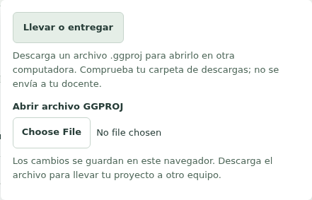
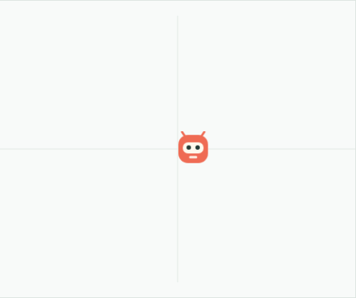

# Preparar una actividad y recuperar trabajo

Esta guía describe el software local. La validación con docentes, lectores de pantalla y equipos escolares sigue pendiente y no se deduce de las pruebas automatizadas.

## Primera creación con acompañamiento docente

En la entrada, «Continuar mi proyecto» aparece cuando se recuperó o abrió una creación. Lleva al contexto actual sin ejecutarlo. «Crear mi primera escena» carga una historia 2D local después de proteger el trabajo actual; si esa protección falla, se conserva el proyecto y se explica el problema. «Explorar una actividad» abre sus instrucciones sin reemplazar el proyecto. «Abrir un proyecto» permite elegir un archivo GGPROJ y valida antes de sustituir la autoría.

Para la primera escena, pedir al estudiante que cambie los pasos de un bloque Mover y cuente qué cree que ocurrirá. Pulsar «Ejecutar bloques», observar y comparar con la predicción. «Detener» conserva los bloques y reinicia el resultado. Desde el escenario, «Volver al programa» e «Ir a Detener» permiten regresar con teclado a esos controles. Las herramientas avanzadas reúnen «Ejecutar ejemplo» y controles GG: ejecutan ejemplos o diagnóstico, no sustituyen la autoría de los bloques visibles.

Nombrar la creación y esperar «Guardado en este navegador» antes de cerrar. Una edición aún pendiente no tiene recuperación garantizada. En Archivo, «Llevar o entregar» solicita un archivo portable .ggproj. Comprueba la carpeta de descargas: Studio no puede confirmar que se haya escrito en disco ni envía el proyecto a tu docente. Al volver en el mismo perfil, continuar el proyecto recuperado y decidir cuándo ejecutar. Si se recuperó un respaldo o falló el almacenamiento, atender el aviso visible y descargar una copia; guardar localmente no equivale a un respaldo externo.

La cabecera muestra dos mensajes independientes. «Guardado en este navegador» confirma el guardado local; «Copia solicitada…» recuerda una solicitud de copia del contenido actual. «Hay cambios desde la última solicitud de copia» indica que debes volver a llevar una copia si quieres incluirlos. «Sin registro de copia en este navegador» también puede aparecer al abrir un archivo en otro perfil: no significa que el archivo sea inválido.

Si falla el almacenamiento, puedes seguir editando, ejecutando y usando «Llevar o entregar». El aviso de fallo local permanece aunque la copia se haya solicitado. «Reintentar guardado local» vuelve a intentar el commit; si solo falló el registro de la copia, Archivo ofrece «Reintentar guardar el registro». Un registro recordado solo en esta sesión no sobrevivirá al cierre. «Seguir trabajando» cierra la ayuda sin descargar.

Esperar la confirmación local antes de cerrar. Un aviso nativo de salida es complementario y depende del navegador: no guarda por sí mismo ni garantiza recuperar una edición pendiente. Para cambiar de computadora, comprobar el archivo portable y abrirlo desde Archivo → Abrir archivo GGPROJ; volver a ejecutar es una decisión explícita.

El acompañamiento puede comprobarse pidiendo una modificación distinta y una explicación. El resultado del programa y los checks automáticos no acreditan por sí solos comprensión. Las edades, el currículo y la duración de la actividad deben acordarse con el docente.

## Preparación con conexión

1. Abrir Studio en el navegador y equipo que usará el alumno. No se requiere cuenta.
2. En «Aprende con una actividad», seleccionar historia animada, juego con puntuación o transición a texto. Leer los pasos antes de cargar el ejemplo: cargar reemplaza el proyecto actual y protege su copia.
3. Descargar un archivo GGPROJ de respaldo. Conservar una copia fuera del almacenamiento del navegador.
4. Abrir «Trabajar sin conexión» y pulsar «Preparar todos los recursos». Esperar la confirmación completa; una preparación cancelada o incompleta no garantiza todos los motores.
5. Cerrar todas las ventanas del navegador. Desconectar la red y volver a abrir la misma dirección en el mismo perfil. Comprobar la actividad y los lenguajes necesarios antes de la clase.

La preparación ocupa almacenamiento de ese perfil. Borrar datos del sitio, usar otro perfil o navegación privada puede eliminar o separar proyectos y paquetes. Una nueva versión se prepara y verifica antes de seleccionarse; se puede volver a la preparación anterior disponible. La actualización no ejecuta automáticamente los proyectos.

## Durante la actividad

Los bloques son la autoría de su documento. Su fuente generada es de solo lectura. «Crear copia» produce un documento JavaScript/Python independiente; editar esa copia no modifica los bloques. Elegir el contexto correspondiente al ejecutar: escena 2D, dispositivo, escena 3D o aplicación web.

Usar los enlaces iniciales de salto y la ayuda «Usar bloques con el teclado». El escenario tiene selección y activación de objetos, incluidos clones. Tab y Escape permiten salir; Stop conserva la autoría. Los errores de consola enlazan al bloque o a la línea cuando existe una referencia válida. Un mensaje de una ejecución anterior no se utiliza para seleccionar autoría nueva.

Descargar periódicamente GGPROJ. El autosave conserva la versión actual y la anterior en IndexedDB; es una ayuda local, no una copia externa. Abrir GGPROJ restaura autoría y recursos sin ejecutar. Los logs, coordenadas modificadas al ejecutar y demás estado mutable del runner no se guardan como autoría.

## Si algo falla

Después de recargar, atender el aviso de recuperación. Descargar una copia recuperada antes de reemplazarla. Un archivo inválido debe mostrar un error y conservar el proyecto activo. Si falta un pack o su versión, conservar el original y preparar la versión requerida; no instalar una extensión arbitraria por indicación del archivo.

Si un programa no responde, pulsar Stop. El host invalida su sesión y reemplaza el ejecutor cuando corresponde. El proyecto y las fuentes permanecen. Para reportar un fallo usar un ejemplo propio mínimo; los archivos pueden contener trabajo de alumnos.

## Compartir y límites

GGPROJ sirve para continuar la autoría. La exportación autónoma 3D/web descarga un ZIP con el runtime seleccionado y un servidor local Node 22; no basta con abrir index.html mediante file://. Seguir el README del paquete. Incluye fuentes y avisos accesibles sin Studio.

La simulación y un HEX compilado no prueban una placa física. WebUSB depende del navegador, del dispositivo y de una selección explícita. No se ha aprobado aún el presupuesto de rendimiento escolar ni un piloto de aula.

## Controles del corte verificado

Las capturas son píxeles reales del grupo afectado aprobado, sin sustituir el
contenido del escenario ni modificar estilos para la imagen.

Archivo conserva una única acción para solicitar el .ggproj. La ayuda pide
comprobar descargas y aclara que no se envía a un docente.

En la semilla de verificación, repetir tres veces un movimiento editado a siete
da x21. Esta captura del canvas acompaña la medición del test, no la reemplaza.
La primera escena del alumno conserva su historia propia.

## Vistas del mismo programa 2D (working tree del 26/10/2026)

En Escena 2D, Bloques, JavaScript y Python muestran el mismo programa. Pedir
primero una predicción; abrir JavaScript, cambiar un número de hero.move y
volver a Bloques. Ese paso comprueba el texto y modifica la autoría; no ejecuta
ni borra el resultado anterior. Ejecutar usa el programa validado desde cualquiera
de las vistas. Python prepara su analizador bajo demanda y puede tardar más.

Si se rechaza el texto, leer la línea y la causa con el estudiante. Seguir
editando vuelve al código; recuperar bloques pide confirmación antes de
descartar texto; Crear copia independiente conserva exactamente el borrador
como otro documento. Deshacer conversión recupera el programa previo sin
reiniciar el resultado. No se ofrecen while, forever ni funciones propias
como bloques 2D en este corte.

La vista activa y el texto pendiente viajan en GGPROJ v5 y autosave; esperar
confirmación local o comprobar la copia descargada antes de cerrar. Los
archivos anteriores siguen legibles. Texto 2D conserva las copias anteriores;
los documentos nuevos usan API3 con eventos y acciones legibles, sin empezar
por GG/await. La consulta Código sigue siendo una lectura derivada.

Micro:bit y 3D/web conservan sus documentos independientes. La revisión 1 de
la actividad De bloques a tu propio código sigue disponible; la revisión 2
basada en editar y volver aún está pendiente. No interpretar este corte como
validación con estudiantes ni como cierre de todo synced-code-views.
